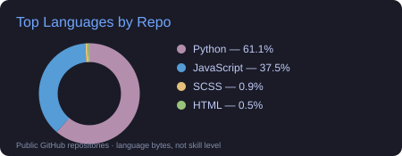
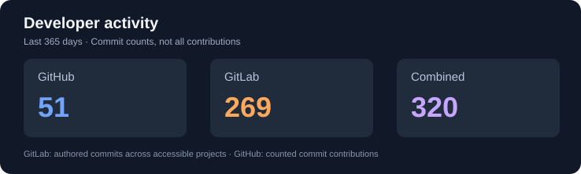
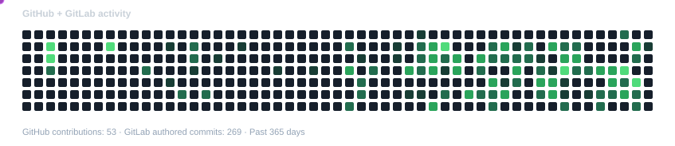

<h1 align="center">Hi , I'm Fabrizio Mori </h1>

  

  

 

  <!---  --> 

	
## <picture></picture> Languages and Tools

<h3 align="left"></h3>

  
  
  
  
  
  
  

  <!-- UNITY -->
  

  <!-- C# -->
  

  <!-- DOCKER -->
  

 

<picture> </picture>

  

- :school: I was a `Cybersecurity Engineering` student at [SENATI](https://www.senati.edu.pe/), a higher technological institute.
- :technologist: I love using Software as a solution for every `Problem`.
- :student: I’m currently learning `Accounting` to expand my skills in `Odoo`.
- :speaking_head: I am working towards my B1 level in English `(IPCNA)`
- :nerd_face: Always `learning new things`.
- :thinking: I’m currently open for a new `job opportunity`, this is MY RESUME.
- :boom: You can visit MY WEBSITE.
 

<h3>My GitHub Stats</h3>

  
  

### 📊 GitHub + GitLab Development Activity

  

## 📬 Connect with me

  
  
  

## 🧩 Development Areas

  
  
  
  
  

---

## 📊 GitHub Activity

  
<b>🔥 Streak Stats</b>

  

  
<b>💻 GitHub Profile Stats</b>

  

  
<b>⚡ Recent GitHub Activity</b>

  

  
<b>📁 My Repositories</b>

  

    
  

  
Custom Odoo 19 modules for POS, inventory, security and business processes.

  
<a href="https://github.com/Fabrizio-HM?tab=repositories">View all my repositories</a>

---

## 🐍 A Snake Eating my Contributions Graph

  <picture>
    <source media="(prefers-color-scheme: dark)" srcset="https://raw.githubusercontent.com/Fabrizio-HM/Fabrizio-HM/activity-stats/github-gitlab-snake.svg" />
    <source media="(prefers-color-scheme: light)" srcset="https://raw.githubusercontent.com/Fabrizio-HM/Fabrizio-HM/activity-stats/github-gitlab-snake.svg" />
    
  </picture>

